<picture>
  <source media="(prefers-color-scheme: dark)" srcset="assets/banner-dark.svg">
  <source media="(prefers-color-scheme: light)" srcset="assets/banner-light.svg">
  
</picture>

  <a href="https://shishir-shastrybh-portfolio.netlify.app"><picture><source media="(prefers-color-scheme: dark)" srcset="assets/btn-portfolio-dark.svg"></picture></a>
  <a href="https://www.linkedin.com/in/shishir%20shastry%20bh"><picture><source media="(prefers-color-scheme: dark)" srcset="assets/btn-linkedin-dark.svg"></picture></a>
  <a href="https://hashnode.com/@shishirbh"><picture><source media="(prefers-color-scheme: dark)" srcset="assets/btn-hashnode-dark.svg"></picture></a>

<picture><source media="(prefers-color-scheme: dark)" srcset="assets/divider-dark.svg"></picture>

<picture><source media="(prefers-color-scheme: dark)" srcset="assets/heading-about-dark.svg"></picture>

  I'm a web developer and system engineer who loves the place where <b>design meets code</b>. 
  I'm into <b>Gen AI</b>, <b>AI agents</b>, web development and design, and I like building websites that make people stop and look.

<table align="center">
  <tr>
    <td>🎨</td>
    <td>Building <a href="https://github.com/ShishirShastry/evora"><b>Evora</b></a>, a free, open-source design and prototyping tool</td>
  </tr>
  <tr>
    <td>🤖</td>
    <td>Currently working on <b>AI agents</b></td>
  </tr>
  <tr>
    <td>🌱</td>
    <td>Learning <b>React</b> and <b>three.js</b></td>
  </tr>
  <tr>
    <td>✍️</td>
    <td>Writing articles on <a href="https://hashnode.com/@shishirbh"><b>Hashnode</b></a></td>
  </tr>
  <tr>
    <td>💬</td>
    <td>Ask me about <b>C</b>, <b>Python</b> and <b>JavaScript</b></td>
  </tr>
</table>

<picture><source media="(prefers-color-scheme: dark)" srcset="assets/heading-featured-dark.svg"></picture>

<a href="https://github.com/ShishirShastry/evora">
  <picture>
    <source media="(prefers-color-scheme: dark)" srcset="assets/evora-dark.svg">
    <source media="(prefers-color-scheme: light)" srcset="assets/evora-light.svg">
    
  </picture>
</a>

  <a href="https://shishirshastry.github.io/evora/"><picture><source media="(prefers-color-scheme: dark)" srcset="assets/btn-evora-site-dark.svg"></picture></a>
  <a href="https://github.com/ShishirShastry/evora/releases/latest"><picture><source media="(prefers-color-scheme: dark)" srcset="assets/btn-download-dark.svg"></picture></a>

<picture><source media="(prefers-color-scheme: dark)" srcset="assets/heading-tech-stack-dark.svg"></picture>

<b>LANGUAGES</b>  
  <picture><source media="(prefers-color-scheme: dark)" srcset="https://skillicons.dev/icons?i=c,cpp,py,js,ts,java,php&theme=dark"></picture>

<b>WEB &amp; APPS</b>  
  <picture><source media="(prefers-color-scheme: dark)" srcset="https://skillicons.dev/icons?i=react,threejs,nodejs,html,css,tailwind,bootstrap,vite,electron&theme=dark"></picture>

<b>AI, DATA &amp; BACKEND</b>  
  <picture><source media="(prefers-color-scheme: dark)" srcset="https://skillicons.dev/icons?i=tensorflow,mongodb,mysql,firebase,postman,selenium&theme=dark"></picture>

<b>TOOLS &amp; DESIGN</b>  
  <picture><source media="(prefers-color-scheme: dark)" srcset="https://skillicons.dev/icons?i=git,github,linux,bash,vscode,figma,blender,ps,arduino,androidstudio&theme=dark"></picture>

<picture><source media="(prefers-color-scheme: dark)" srcset="assets/heading-github-stats-dark.svg"></picture>

<picture>
  <source media="(prefers-color-scheme: dark)" srcset="https://raw.githubusercontent.com/ShishirShastry/ShishirShastry/output/stats-dark.svg">
  
</picture>

  <picture>
    <source media="(prefers-color-scheme: dark)" srcset="https://raw.githubusercontent.com/ShishirShastry/ShishirShastry/output/languages-dark.svg">
    
  </picture>
  <picture>
    <source media="(prefers-color-scheme: dark)" srcset="https://raw.githubusercontent.com/ShishirShastry/ShishirShastry/output/streak-dark.svg">
    
  </picture>

<picture>
  <source media="(prefers-color-scheme: dark)" srcset="https://raw.githubusercontent.com/ShishirShastry/ShishirShastry/output/activity-dark.svg">
  
</picture>

<picture>
  <source media="(prefers-color-scheme: dark)" srcset="https://raw.githubusercontent.com/ShishirShastry/ShishirShastry/output/snake-dark.svg">
  
</picture>

<picture><source media="(prefers-color-scheme: dark)" srcset="assets/divider-dark.svg"></picture>

  Thanks for stopping by. The cards above are drawn by this repository's own <a href=".github/workflows/cards.yml">GitHub Action</a> and refresh every day.  
  

